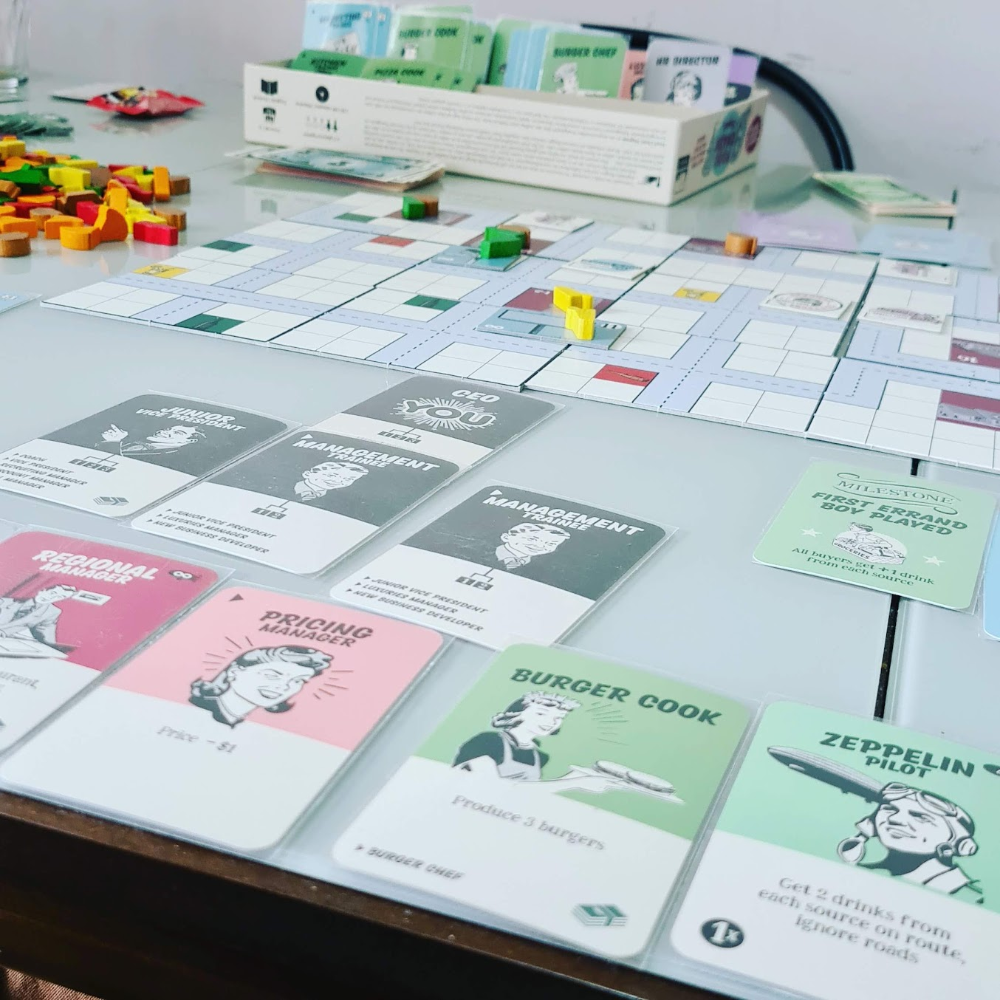
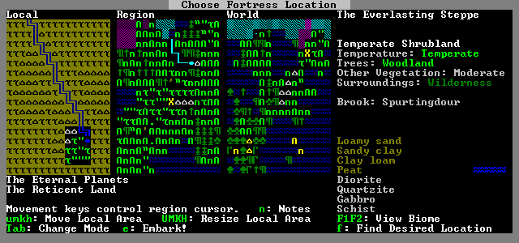

> I am sorry, reader, but I am not here to defend you, especially because you are not ugly.

To start with a disclaimer, design is not my area of expertise; I do not claim to be an expert in any of this, and you should feel free to correct or bash me as you wish.
I am just sharing some thoughts I have been having for a while.

Design is a very broad and well-studied area, and all the modern algorithms take a lot of advantage of it to keep you hooked. When I came up with this title[^1],
I actually wondered if there were good reads on the internet about this topic, and I found these two articles,
[The case for ugly design](https://www.fastcompany.com/90672231/the-case-for-ugly-design) and [Cult of the ugly](https://www.eyemagazine.com/feature/article/cult-of-the-ugly), and this tangential video I watched a while back complaining about why [Nothing looks cool anymore](https://www.youtube.com/watch?v=HgjXjPP_p3s).

[^1]: I did read [a text](https://revista.fdsm.edu.br/index.php/revistafdsm/article/view/321/312) in Portuguese, but it carried the bias of marginalized art being considered ugly. I found it after I had already written this, and it was not exactly the point I wanted to make, but it is related.

The video discusses how people see design. Some just care for the beauty, more educated folks care about how form should follow function, and then it tells you that how design makes you feel, and what it means and evokes, is what matters.

The two texts focus a little more on how designers do purposeful ugly design, to convey something to you as a form of "non-conformity", to
lure you to their brands, and to try to invent discomfort. Those two texts are fair, but they take the side of the professional designer and the normie audience, and it almost reads like a designer circlejerk. My case here is that you should experiment with ugly and weird things. I like some questionable things, and I think you should try them before frowning upon them.

All this introduction is because I wanted to say that I care first and foremost about good gameplay. Yes, gaming, board gaming, all gaming, and some questionable storytelling.

We all grew up hearing "Don't judge a book by its cover", yet here we are. Whenever I want to share weird stuff with my friends, I have to think about whether
it will be presentable enough for them to even bother looking at it. Or I go on a deep side quest to convince them that it is worth a look, sometimes even bribing them. The perks of being a good cook :cook:.

At least I know I am not serving them the bland beauty of social media, copied but not the same, replicated a hundred times, expecting the same reaction and being satisfied with it.

## Bold of me to assume

Let's start with my venting in the theme I care most about sharing with people, board games. I was lucky in my early board gaming career; I had big groups and a great store nearby which I frequented quite a lot, probably more than I should have. That was good because back then I was just a broken university student,
but I could figure out what I liked before I had money to spend on it; now I have a collection that I am quite proud of, and I didn't have to buy and resell things too much.

In that, I ended up going for heavy games, usually the more complex the better. I liked exploring rules and having complex things to dive my mind into and, to my partner's detriment,
pulling her into playing those nonsense games with me. I can't complain, as she does her best and I think she enjoys it, maybe just my company, or at least she fakes it very well.

Here is the catch, though. I went down a rabbit hole to find some really interesting games, and I have to say, they're not always eye candy, but boy, do I love them, and I wish my friends did as well.

Not to say that I don't enjoy a beautiful game. [Root](https://boardgamegeek.com/boardgame/237182/root) is probably the best bait you could ask for to lure friends in. Those little angry cats, birds and rabbits ready to puncture your gut with a knife really know how to drag your friends into a fun trap.

Unfortunately, more often than not, it is the opposite. Modern games are going all-in on beautiful production, full of miniatures and stuff to lure you into some mediocre, soulless gameplay, which is really a shame, and you have to pay thrice the price for it. The problem is that board games are meant primarily to be played, not to sit on your shelf like a marble bust.

I'm still trying to convince my friends that managing a 1950s restaurant will be the best cut-throat board game experience they could have, and I fail miserably. I am not even going to talk about the majestic world of beige games.

About [Food Chain Magnate](https://boardgamegeek.com/boardgame/175914/food-chain-magnate/) specifically, people claim that it looks like a prototype, that it is absolutely ugly and expensive. They're kind of right about the latter, and I would still pay double the price for how much I like it. I don't personally think the white board is bad; it helps read the table without many distractions and allows the gameplay to flourish, not the toy. But how can I convince others of it?




## Digital stuff

> "I want shorter games with worse graphics made by people who are paid more to work less and I'm not kidding" - the indie gamers

I don't really want them to be short, just engaging enough that a short game feels long. I guess that the indie scene for gaming is far better supported,
at least in the bubble I live in, so I will not expand much here.

Nonetheless, if you are one of those for whom modern hyperrealism and `DLSS 5` graphics are all that matters, I guess you should try something different. I swear that those pixelated (pixel art, for the sommeliers) and low-polygon games are worth it: they're cheaper and have neat ideas and work anywhere. There are a bunch I
could recommend to you. But today I am in the mood for something radical. Try [Dwarf Fortress](https://www.bay12games.com/dwarves/)[^2]; it is free. It has a cool concept, colony/god game (RimWorld and alikes), but the catch is that the graphics are all ASCII, meaning only PC characters. Then you come back here and call me a sicko. I don't care.

[^2]: There is a pretty version of Dwarf Fotress on [steam](https://store.steampowered.com/app/975370/Dwarf_Fortress/), if you want to pay and dislike small letters.



I have a game designer friend who says that games should have as little text as possible. I hope you don't have a stroke.

Just as a side note, ASCII art is very cool ([tool used](https://github.com/LeandroBarone/python-ascii_magic)), you can do things like this:

<!--  -->
[](/ascii/frieren_ascii.html)


And the intro of your favorite CLIs:

```text 
  ___   __| || |__    ___ | || |
 / _ \ / _` || '_ \  / _ \| || |
|  __/| (_| || | | ||  __/| || |
 \___| \__,_||_| |_| \___||_||_|
```


## My point

I just think that, in a world full of polished and dull beautiful things, we should give the weird and uglier things a chance.

They are usually someone trying to create something. The ugliness may be just the point, or it may just as well be someone trying their best, or working with intentional limitations or goals.

Where else could you meet Pentacles the Putrid and the Poly gods? Just in Dreamland — If you like real weird shit, check on [Spotify](https://open.spotify.com/episode/6wcKP4p1wkgJHwc8G2rmfR?si=2bf36b9418f3432b) and [Instagram](https://www.instagram.com/elliottruman/).
