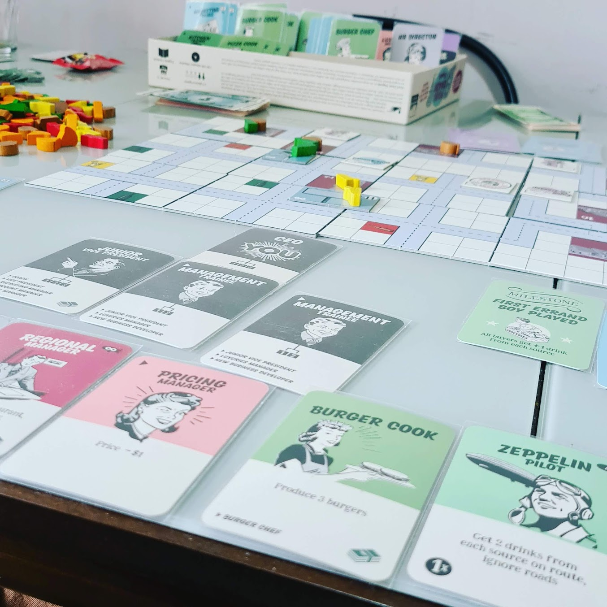
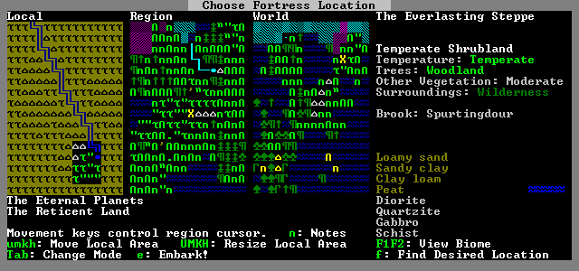
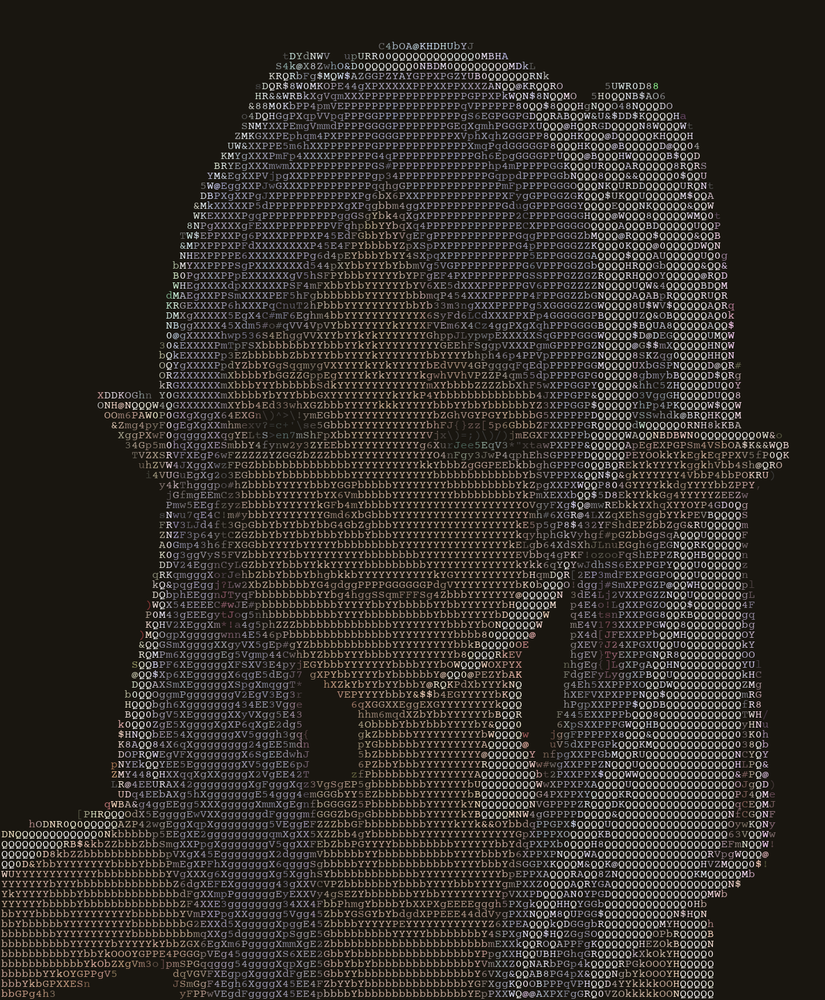

> Sinto muito, leitor, mas não estou aqui para te defender, até porque você não é feio.

Para começar com um aviso, design não é a minha área de especialidade. Não me considero especialista, e sinta-se à vontade para me corrigir ou me xingar como preferir.
Estou apenas compartilhando alguns pensamentos que venho tendo há um tempo.

Design é uma área muito ampla e bem estudada, e todos os algoritmos modernos tiram bastante proveito disso para te manter viciado. Quando pensei neste título[^1] (em inglês),
fiquei pensando se havia boas leituras na internet sobre o assunto, e acabei encontrando estes dois artigos,
[The case for ugly design](https://www.fastcompany.com/90672231/the-case-for-ugly-design) e [Cult of the ugly](https://www.eyemagazine.com/feature/article/cult-of-the-ugly), e este vídeo tangencial que assisti um tempo atrás reclamando de por que [Nothing looks cool anymore](https://www.youtube.com/watch?v=HgjXjPP_p3s).

[^1]: Eu cheguei a ler [um texto](https://revista.fdsm.edu.br/index.php/revistafdsm/article/view/321/312) em português, mas eles tinham o viés de arte marginalizada ser considerada feia, mas isso foi depois que já tinha escrito e não era exatamente o ponto que eu queria chegar, mas é relacionado.

O vídeo discute como as pessoas veem o design. Algumas só se importam com a beleza, as mais letradas se importam com como a forma deve seguir a função, e aí ele te diz que como o design te faz sentir, e o que ele significa, é o que importa.

Os dois textos focam um pouco mais em como designers fazem design feio propositalmente, para te transmitir algo como uma forma de "não conformidade", para
te atrair para suas marcas, e para tentar inventar desconforto. Os dois textos são justos, mas ficam do lado do designer profissional e do público normie, e quase parece um _circlejerk_. Meu argumento aqui é que você deveria experimentar coisas feias e estranhas. Eu gosto de algumas coisas questionáveis, e acho que você deveria experimentá-las antes de olhar de cara feia.

Toda essa introdução é porque eu queria dizer que me importo, antes de qualquer coisa, com gameplay bom. Sim, jogos, jogos de tabuleiro, todos os jogos, e histórias questionáveis.

Todos nós crescemos ouvindo "não julgue o livro pela capa", mas aqui estamos. Sempre que quero compartilhar coisas estranhas com meus amigos, tenho que pensar se
vai ser apresentável o suficiente para eles ao menos se darem o trabalho de olhar, ou então partir numa side quest profunda para convencê-los de que vale a pena, às vezes até subornando. As vantagens de ser um bom cozinheiro :cook:.

Pelo menos sei que não estou servindo a eles a beleza sem graça das redes sociais, copiada mas não igual, replicada cem vezes, esperando a mesma reação e ficando satisfeito com isso.

## Que ousadia a minha supor

Vamos começar pelo meu desabafo no tema que mais gosto de compartilhar com as pessoas, jogos de tabuleiro. Tive sorte no começo da minha jornada com jogos de tabuleiro; tinha grupos grandes e uma loja ótima por perto que eu frequentava bastante, provavelmente mais do que deveria. Isso foi bom porque, na época, eu era só um universitário quebrado, mas consegui descobrir do que gostava antes de ter dinheiro para gastar com jogos; agora tenho uma coleção da qual me orgulho bastante, e não preciso ficar revendendo muita porcaria.

Nisso, acabei indo para jogos pesados, geralmente quanto mais complexo, melhor. Eu gostava de explorar regras e ter coisas complexas para mergulhar a cabeça e, em detrimento da minha parceira,
arrastá-la para jogar esses nonsense comigo. Não posso reclamar, ela faz o possível e acho que gosta, talvez só da minha companhia, ou pelo menos disfarça muito bem.

O detalhe é o seguinte. Entrei numa toca de coelho para achar uns jogos realmente interessantes, e preciso dizer, eles não são sempre lindos, mas como eu amo eles, e queria que meus amigos também apreciassem.

Não que eu não goste de um jogo bonito. [Root](https://boardgamegeek.com/boardgame/237182/root) é provavelmente a melhor isca que você poderia pedir para pegar os desavisado. Aqueles gatinhos bravos, passarinhos e coelhos prontos para furar a sua barriga com uma faca sabem muito bem como arrastar seus amigos para uma armadilha divertida.

Infelizmente, mais frequentemente do que não, é o contrário. Jogos modernos estão apostando tudo na produção bonita, cheios de miniaturas e coisas para te atrair para um gameplay medíocre e sem alma, o que é realmente uma pena, e você tem que pagar o triplo do preço por isso. O problema é que jogos de tabuleiro existem primordialmente para serem jogados, não para ficar na sua estante como um busto de mármore.

Ainda estou tentando convencer meus amigos de que administrar um restaurante dos anos 1950 será a melhor experiência de jogo de tabuleiro sanguinária que eles poderiam ter, e falho miseravelmente. Nem vou falar do majestoso mundo dos jogos bege.

Sobre [Food Chain Magnate](https://boardgamegeek.com/boardgame/175914/food-chain-magnate/) especificamente, as pessoas dizem que parece um protótipo, que é absolutamente feio e caro. Elas estão meio certas quanto ao segundo, e eu ainda pagaria o dobro do preço pelo quanto gosto dele. Pessoalmente, não acho o tabuleiro branco ruim; ele ajuda a ler a mesa sem muitas distrações e deixa o gameplay florescer, não o brinquedo. Mas como convencer os outros disso?




## Coisas digitais

> "Eu quero jogos mais curtos com gráficos piores feitos por pessoas que são pagas mais para trabalhar menos e não estou brincando" - os gamers indie

Eu não quero realmente que eles sejam curtos, só envolventes o suficiente para que um jogo curto pareça longo. Acho que a cena indie de jogos é muito melhor apoiada,
pelo menos na bolha onde eu vivo, então não vou me estender muito aqui.

Mesmo assim, se você é daqueles para quem o hiper-realismo moderno e os gráficos do `DLSS 5` são tudo o que importa, acho que você deveria tentar algo diferente. Juro que esses jogos pixelados (pixel art, para os _sommeliers_) e de baixo polígono valem a pena: são mais baratos e têm ideias legais e rodam em qualquer lugar. Poderia recomendar vários deles, mas hoje estou no clima de fazer algo radical. Tente [Dwarf Fortress](https://www.bay12games.com/dwarves/)[^2]; é de graça. A ideia é bem legal, jogos de colônia/deus (estilo RimWorld e similares), mas o detalhe é que os gráficos são todos ASCII, ou seja, só caracteres de PC. Depois você volta aqui e me chama de doente. Não me importo.

[^2]: Existe uma versão bonita na [steam](https://store.steampowered.com/app/975370/Dwarf_Fortress/) se você quiser paagar e não gostar tanto das letrinhas.



Tenho uma amiga designer de jogos que diz que jogos deveriam ter o mínimo de texto possível. Espero que você não tenha um derrame.

Desviando um pouco, arte ASCII é muito legal ([ferramenta usada](https://github.com/LeandroBarone/python-ascii_magic)), você pode fazer coisas como essa:

<!--  -->
[](/ascii/frieren_ascii.html)


E a intro para das suas CLIs favoritas:

```text
  ___   __| || |__    ___ | || |
 / _ \ / _` || '_ \  / _ \| || |
|  __/| (_| || | | ||  __/| || |
 \___| \__,_||_| |_| \___||_||_|
```


## Meu ponto

Eu só acho que, num mundo cheio de coisas bonitas, polidas e sem graça, deveríamos dar uma chance para as coisas estranhas e mais feias.

Elas geralmente são alguém tentando criar algo. A feiura pode ser justamente o ponto, ou pode muito bem ser alguém dando o seu melhor, ou trabalhando com limitações ou objetivos intencionais.

Onde mais você poderia conhecer _Pentacles the Putrid_[^3] e os _Poly Gods_[^4] ? Só em Dreamland — se você curte coisas bem esquisitas, confira no [Spotify](https://open.spotify.com/episode/6wcKP4p1wkgJHwc8G2rmfR?si=2bf36b9418f3432b) e no [Instagram](https://www.instagram.com/elliottruman/).


[^3]: Pentáculos o Pútrido.
[^4]: Deuses polígonos.