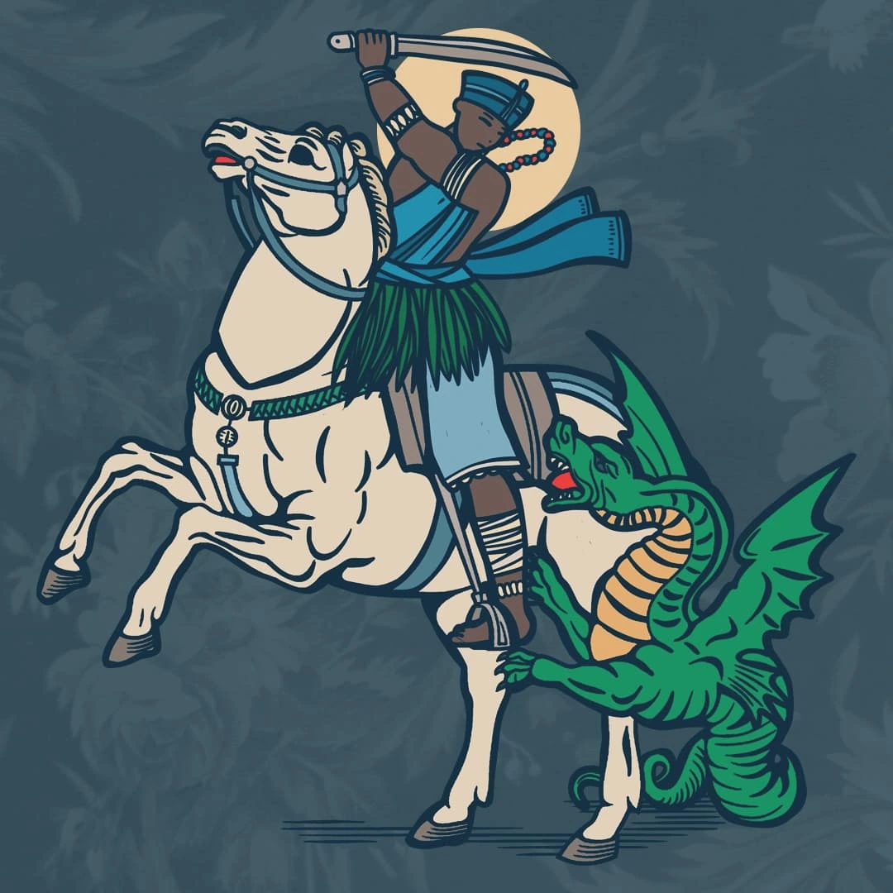
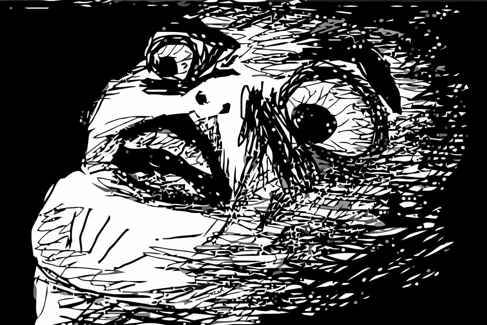

I had been thinking how much I used to like the internet. In fact, I still do very much. The thing
is that to me, "the internet" is not what we interact most of the time anymore. We usually refer to modern platforms as if they were it. 
Reddit, Discord, X (yeah, former whatever), all the Meta's spawns, the list goes on. But that is just the Platform internet, 
not the one we like, at least not the one I like.

I also don't  want to be a hermit, I am not disconnecting, convenience is good but sometimes it is just too much.
I want people to find me and it not to be a hassle. And I still need to check if my mom is not falling for something 
at the time sucker scrolling platforms.

[_Hic sunt dracones_](https://en.wikipedia.org/wiki/Here_be_dragons), and we must avoid them

I've always pretended that I stand for freedom, the open internet, open source code, easy and free access and all of that.
I have even lied to myself that by leaving some code in a git _platform_ I was doing my part. But now I don't think
that it is enough. Something, but not enough.

I know that I don't want to fall for the traps, the most recent one is people thinking that Discord is an appropriate place to store things.
It is conveniet, but it is also hidden, it is annoying to search, you and your things are not as safe there as you might think. 
All these ideas, print-and-play, mods, cool stuff, in a constant risk of vanishing, without a backup.
And it is not even a place the Wayback Machine could save us. Not sure if it can even save itself, but I digress.

That is why I created [thehellas.com](https://www.thehellas.com), this website. I want to see the internet of passionate people back.
Where you could navigate around and find stuff, some really cool, some dorky as hell but things made by people, with passion,
with intent of sharing knowledge, not... _content_.

> If you want to tell me you don’t care about something, call it content. — Dan Thurot [(Space-Biff!)](https://spacebiff.com/2026/04/27/wendybuxxx/)

I remember when I was surfing around websites, forums, geocities, questionable ephemeral chats and I would stumble into a link, 
a comment that could send me to the other side of the web. Somehow I was deep into leather craft. It used to be just like 
exploring a city and finding that weird Bookshop Café that had always been there but you had never noticed it. The old dust is refreshing.

That is my goal, and my new contribution to the internet, a free space far from the corporate overlords (only github pages for now ¯\\\_(ツ)_/¯ ). 
I want to share whatever I like, write a bit, no specific topic. 
In hopes that maybe you could enjoy some of it as well. You can find some links to stuff that I like at the [Cool Links]() tab.
I plan to update it from time to time, add places in the future, like that Bookshop Café that I visited earlier, maps directions? I don't know, I will figure it out.

What you will not find here, and I shall stand against is AI... _content_. I want to respect you, your time and myself. It is not that I am against AI, just
AI slop and, most importantly, AI art. AI coding? Maybe, ain't nobody got time for editing `.css` files. But this little corner of the internet look marvelous
because someone did something beautiful before, the layout here comes from the great [Omegion](https://github.com/omegion/hugo-omegion) theme that was built by someone.
I did some tweaks with AI, front end is not really my strongest. And it gives us some real power, I hope not to become too used to it and my
~~googlefu~~ [DuckDuckFu](https://duckduckgo.com/) skills dies with it.

Still in the AI topic, I am also afraid that my brain rots with it, and I don't want it to. So, another thing I want to have here is something interesting for us to read, reduce the doom scrolling _brainrot_. Lets think a little, read, enjoy art. And I mean art, by people, even when you don't know who they are, but they evoke you something.

For this particular one, some nostalgia of the internet.

As a final note, you are always free to contact me through [Mail me](mailto:ehellas@proton.me) section or some other way you find.

For all my potential readers, I will try to sync it in two languages, but the pages my diverge of each other a little. Seem a daunting task, but
I want it to be inclusive.

You are all welcome.