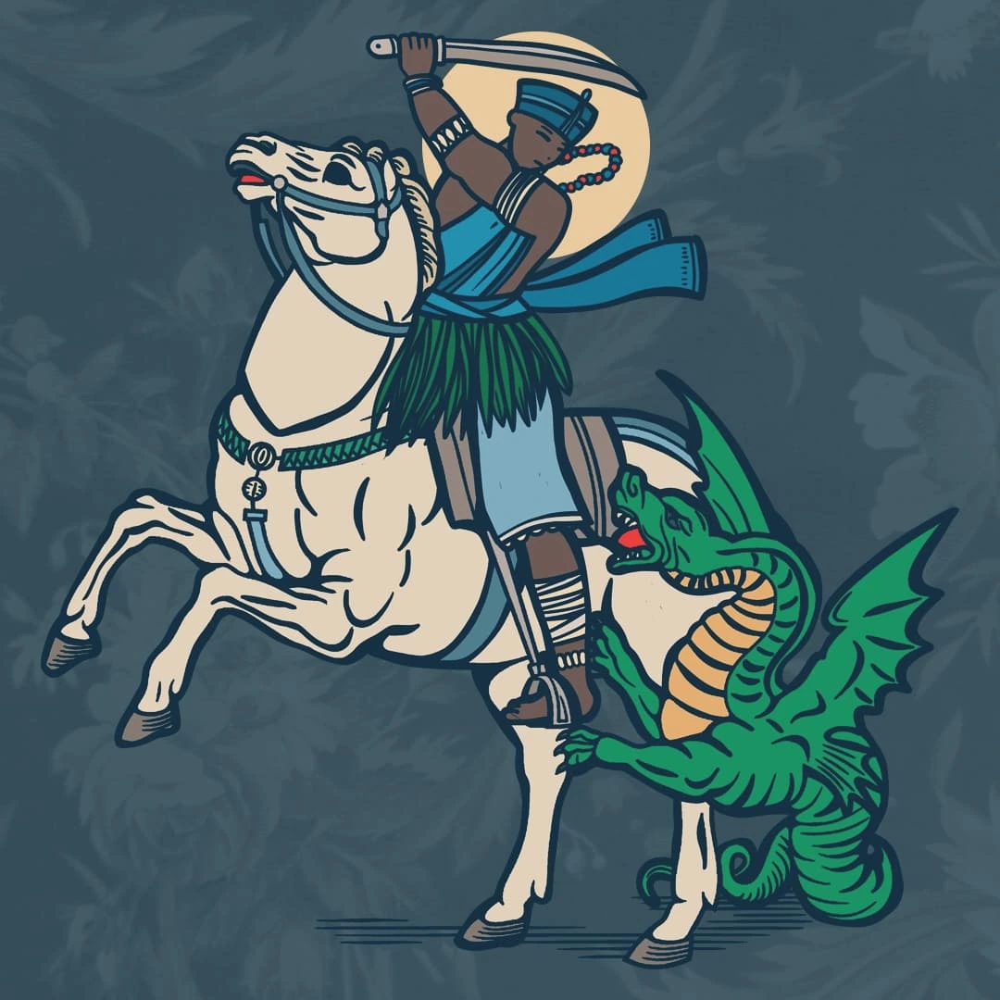
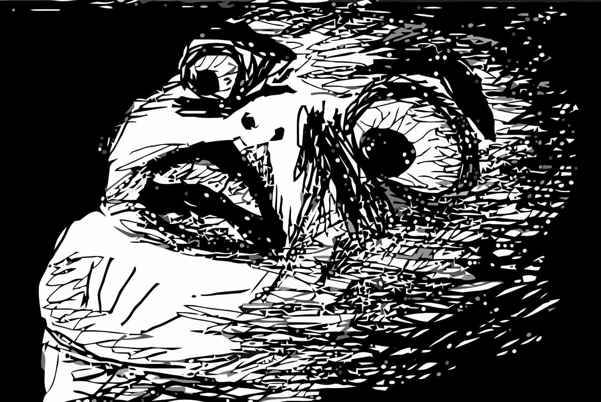

Eu estava pensando em como eu costumava gostar da internet. Na verdade, eu ainda gosto muito. A questão
é que, para mim, "a internet" não é mais aquilo com que interagimos na maior parte do tempo. Nos acostumamos
nos referir às plataformas modernas como se fossem. Reddit, Discord, X (é, esse mesmo), todos
os filhotes diabólicos da Meta, a lista continua. Mas isso é só a internet das Plataformas, não a que gostamos, pelo
menos não a que eu gosto.

Também não quero ser um ermitão, não estou me desconectando, a conveniência é boa, mas às vezes é demais.
Quero que as pessoas me encontrem e que isso não seja um transtorno. E eu ainda preciso checar se minha mãe
não está caindo em alguma coisa dessas plataformas que tem sugam nas rolagens.

[_Hic sunt dracones_](https://pt.wikipedia.org/wiki/Here_be_dragons), e devemos evitá-los

Eu sempre fingi que defendia a liberdade, a internet aberta, o código aberto, o acesso fácil e gratuito.
Cheguei até a mentir para mim mesmo que, ao deixar códigos em uma _plataforma_ de git, eu estava fazendo a minha parte. Mas agora não acho
que seja o suficiente. É algo, mas não o suficiente.

Eu sei que não quero cair em algums armadilhas, a mais recente são as pessoas achando que o Discord é um lugar apropriado para guardar coisas.
É prático, mas também é escondido, é ruim de fazer buscas, você e suas coisas não estão seguras lá.
Todas essas ideias, print-and-play, mods, coisas legais, num risco constante de sumir, sem backup.
E não é nem um lugar que a Wayback Machine poderia nos salvar. Não sei se ela consegue salvar a si mesma, mas enfim.

É por isso que criei o [thehellas.com](https://www.thehellas.com), este site. Quero ver de volta a internet das pessoas apaixonadas.
Onde você podia navegar e encontrar coisas, algumas bem legais, outras bobas pra caramba, mas coisas feitas por pessoas, com paixão,
com a intenção de compartilhar conhecimento, não... _conteúdo_.

> Se você quer me dizer que não se importa com algo, chame de conteúdo. — Dan Thurot [(Space-Biff!)](https://spacebiff.com/2026/04/27/wendybuxxx/)

Lembro de quando eu navegava por sites, fóruns, geocities, chats efêmeros duvidosos e esbarrava num link,
num comentário que podia me levar para o outro lado da internet. De algum jeito eu fui parar bem fundo em artesanato em couro. Era como
explorar uma cidade e encontrar aquela Livraria-Café esquisita que sempre esteve ali mas você nunca tinha notado. A poeira antiga é revigorante.

Esse é meu objetivo, e minha nova contribuição para a internet, um espaço livre longe dos senhores corporativos (só o github pages por enquanto ¯\\\_(ツ)_/¯ ).
Quero compartilhar o que gosto, escrever um pouco, sem assunto específico.
Na esperança de que talvez você goste um pouco também. Você pode encontrar alguns links de coisas que eu gosto na aba [Links Legais]().
Pretendo atualizá-la de tempos em tempos, adicionar lugares no futuro, como aquela Livraria-Café que eu visitei agora pouco, direções no mapa? Não sei, vou pensar em algo.

Entretanto, o que você não vai encontrar aqui, e vou me posicionar contra, é IA e seu...  _conteúdo_. Quero respeitar você, o seu tempo e a mim mesmo. Não é que eu seja contra IA, só
contra _slop_ de IA e, mais importante, arte de IA. Código com IA? Talvez, ninguém tem tempo de editar arquivos `.css`. Mas este cantinho da internet ficou maravilhoso
porque alguém fez algo bonito antes, o layout daqui vem do ótimo tema [Omegion](https://github.com/omegion/hugo-omegion) que foi feito por alguém.
Eu fiz alguns ajustes com IA, front end não é realmente meu forte. E isso nos dá um poder de verdade, espero não me acostumar demais e minhas
habilidades de ~~googlefu~~ [DuckDuckFu](https://duckduckgo.com/) morrerem com isso.

Ainda no tema IA, também tenho medo de o meu cérebro apodrecer com ela, e não quero que isso aconteça. Então, outra coisa que quero ter aqui é algo interessante para lermos, reduzir o _brainrot_ da rolada da perdição. Vamos pensar um pouco, ler, curtir arte. E quero dizer arte, feita por pessoas, mesmo quando você não saiba quem elas são, mas te despertam algo.

Para esta em particular, um pouco de nostalgia da internet.

Para acabar, você é sempre livre para falar comigo através do [Me escreva](mailto:ehellas@proton.me) ou de qualquer outro jeito que você encontrar.

Para todos os meus potenciais leitores, vou tentar manter posts nos dois idiomas, mas as páginas podem divergir um pouco entre si. É um pouco desafiador, mas
quero que seja inclusivo.

Sejam bem-vindos.